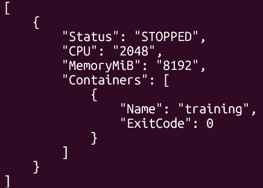
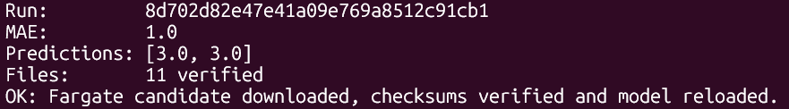

# AWS Fargate training verification

A forecasting project generated from the AWS training branch was tested
on AWS on November 17, 2026.

## Test scope

The generated project used a small synthetic pipeline with four CSV rows.
The trainer fitted a constant-mean model using two rows and evaluated it
on two validation rows.

This verifies infrastructure and artifact handling, not business-model quality.

The test exercised:

- The generated training container and project pipeline factory.
- ECS/Fargate execution with the generated execution and task roles.
- S3 input download and KMS-backed artifact storage.
- Local MLflow tracking inside the training task.
- Model, serving-artifact and evaluation export.
- S3 upload followed by a completion marker.
- Download, checksum verification and model reload.

## Results

| Check | Result |
| --- | --- |
| ECS task status | STOPPED |
| Training container exit code | 0 |
| Training rows | 2 |
| Validation rows | 2 |
| Validation MAE | 1.0 |
| Reloaded predictions | [3.0, 3.0] |
| Uploaded files verified | 11 |
| Candidate promoted | false |

MLflow run ID: `8d702d82e47e41a09e769a8512c91cb1`

Fargate result ID: `fargate-698539a98a1e41e9b40b59052d7e4b8e`

The completion inventory and candidate metadata checksums matched the
downloaded files. The exported model loaded successfully and reproduced
the expected predictions.

## Evidence

## Remaining limitations

- Classification training is covered by automated local and container tests,
  but was not separately executed on AWS in this verification.
- SageMaker request generation and Terraform configuration are tested;
  SageMaker cloud execution remains unverified because the selected training
  instance quota was zero.
- Non-root access to SageMaker-mounted directories remains unverified.
- The generated API deployment was not exercised by this training test.
- Candidates are not automatically registered, promoted or activated.

## Cleanup

All 45 Terraform-managed resources of the test deployment were destroyed
after verification and screenshot capture. Terraform state was checked
and was empty.

The KMS key and Secrets Manager resource were scheduled for deletion using
their configured recovery windows rather than deleted immediately.

Local verification artifacts and screenshots were retained.